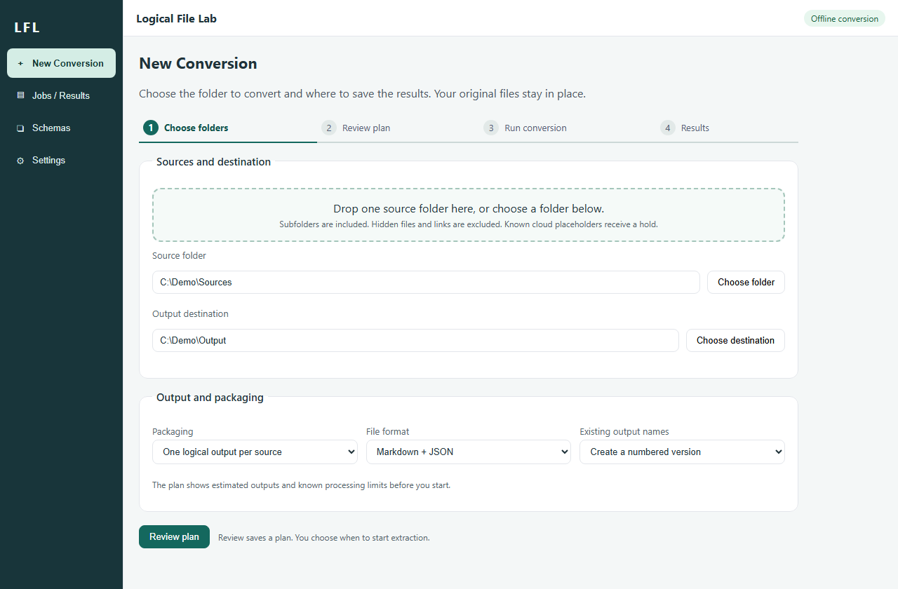

# Logical File Lab

Before you ask AI about a statute set or exhibit bundle, check three things.
Did the wording survive conversion? Which file did it come from? What still
needs review? Logical File Lab prepares Markdown and JSON with the full
extracted text, a record for each source, and the gaps flagged during conversion.

[Try the amendment example](https://methos801.github.io/logical-file-lab/#amendments) · [Open the 90-second walkthrough](https://methos801.github.io/logical-file-lab/#demo) · [Read the Windows user manual](docs/user-manual.md) · [Browse the synthetic examples](examples/)

## Two ways to use it

- **Windows app.** Choose sources, review the plan, and inspect the outputs and receipt.
- **Command line.** Use the same engine from scripts or other workflows. It returns
  results as JSON and streams structured progress events as JSONL.

Conversion runs offline and keeps originals in place. You choose which outputs to provide to an AI tool.

## Compare two similar amendments

The two fictional amendments have the same title and section number. The
notice period is ten days in one and thirty days in the other. The manifest
lists both original filenames and source IDs. Each record in the combined
bank retains its own full extracted text and outline, so you can ask for
Section 4.2 from each and check the quotes against the originals.
[Check each citation against the original and bank](https://methos801.github.io/logical-file-lab/#check-citations).
[Original amendments](examples/Legal-Amendments/) · [Manifest](docs/demo/amendments/64081daa55ad4ab5a30cac8e5d50d9d9/00_manifest_controller.md) · [Markdown bank](docs/demo/amendments/64081daa55ad4ab5a30cac8e5d50d9d9/00_sources_0001_bank.md) · [JSON bank](docs/demo/amendments/64081daa55ad4ab5a30cac8e5d50d9d9/00_sources_0001_bank.json) · [Receipt](docs/demo/amendments/64081daa55ad4ab5a30cac8e5d50d9d9/run_receipt.json)

## Try the Cedar Relay walkthrough

1. **Review the plan.** Three fictional workshop records produce one logical output per source in Markdown and JSON. [Source files](examples/Sources/) · [Saved plan](docs/screenshots/preflight.png)
2. **Compare the text.** Find the final inventory tag `CR-FINAL-317` in the
   source and both full exports. [Original](docs/demo/cedar-relay-source.md) · [Markdown](docs/demo/cedar-relay-logical.md) · [JSON](docs/demo/cedar-relay-logical.json)
3. **Read the receipt.** The three-file run records three passes and six source
   exports. The separate duplicate-header CSV shows how a review hold appears
   while the source text stays available. [Receipt excerpt](docs/demo/receipt-excerpt.json) · [Hold screenshot](docs/screenshots/results-hold.png)

Use one logical file per source, one combined bank, or several grouped banks.
Banks keep identifiable records for each source. The manifest routes readers
to those records. [Sample Markdown bank](docs/demo/cedar-relay-combined.md) · [Sample JSON bank](docs/demo/cedar-relay-combined.json)

The fictional statute example includes 4,500 sections across three titles.
Both formats preserved its Unicode text and final marker in the Windows
review build. [See the Windows results](docs/screenshots/results-unicode.png)

## Preview scope

The Windows application is in private review. Its current source and bank text limits
are 64 MiB. The preview works best with UTF-8 text, Markdown, CSV and TSV.
Word and PDF extraction can depend on installed converters. Review coverage
holds alongside the original source.

The outputs include extracted source text even when structural coverage needs review.

**Test notes.** The preview ZIP passed startup, synthetic conversion, and
forced interruption and recovery on a second Windows 11 x64 machine.
[Preview test notes](https://methos801.github.io/logical-file-lab/#windows-test)
