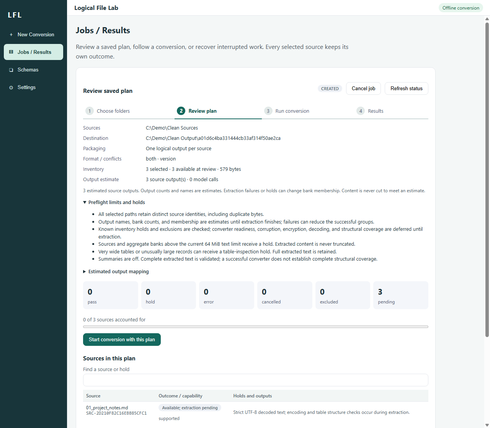
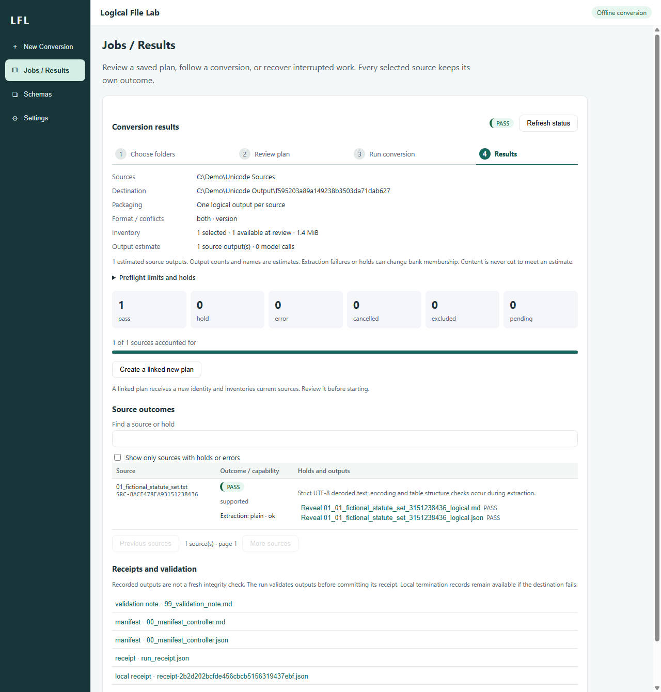
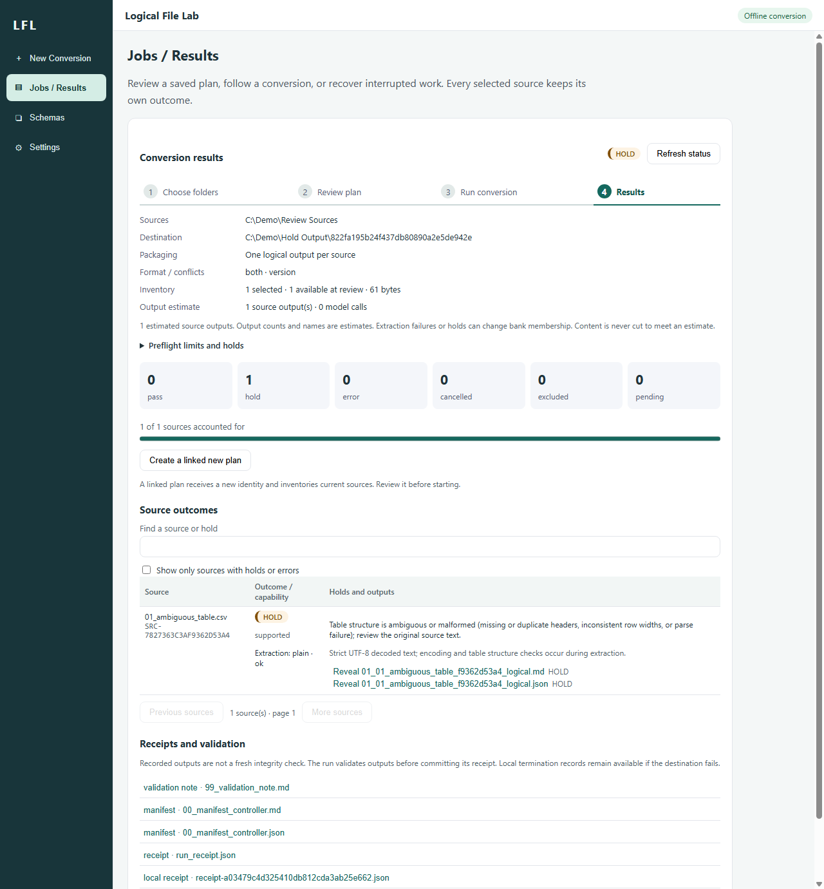

# Logical File Lab Windows user manual

This manual covers the portable Windows preview. Use it to convert a folder of source files into auditable Markdown or JSON. Each source has its own identity and outcome, including when you choose to package several sources in a bank.

## Start the app

1. Use Windows 11 x64 with the Microsoft Edge WebView2 Runtime and current Visual C++ x64 Redistributable installed. If a prerequisite is missing, use Microsoft's downloads or your organization's software approval process. [WebView2 Runtime](https://developer.microsoft.com/en-us/microsoft-edge/webview2/#download-section) · [Visual C++ Redistributable](https://learn.microsoft.com/en-us/cpp/windows/latest-supported-vc-redist)
2. Extract the app ZIP into a new folder. Keep **Logical File Lab.exe** and **lfl.exe** together.
3. Launch **Logical File Lab.exe**. The preview is unsigned. If your organization blocks unsigned apps, follow its software approval process.
4. For a practice run, extract the synthetic examples ZIP separately. You can also use this repository’s [examples](../examples/) folder.

The app runs offline and requires no account or AI model for conversion.
To check a download, run `Get-FileHash -Algorithm SHA256 .\Logical-File-Lab-Windows-Preview.zip` in PowerShell and compare it with the digest on the release listing for that build.

The screenshots use the app's frontend and saved job results from the fictional examples. They show example paths under `C:\Demo`.

## Convert a folder

1. Under **New Conversion**, drop a folder into the drop area or use **Choose folder**. Begin with `examples/Sources` for a three-file practice run.
2. Use **Choose destination** to select a separate output folder outside your source folder. The app creates a job-specific folder inside it. Subfolders of the selected source folder are included. Hidden files and links are excluded. Known cloud placeholders receive a hold.
3. Pick the packaging and file format. **One logical output per source** with **Markdown + JSON** is a practical starting point. **Create a numbered version** is the default when an output name conflicts.
4. Click **Review plan**. Check the source and destination, the estimated outputs, and the preflight limitations. Availability is checked at review time. Some issues, including decoding problems and missing converters, are confirmed during extraction.
5. Use **Start conversion with this plan**. Follow the current stage and source counts in **Jobs / Results**. Recent updates show that the controller is responding. Use the source counts and final receipt to confirm what finished.

You can use **Tab** and **Shift+Tab** to move between controls, **Enter** to activate a button, and the arrow keys to change a focused dropdown. Scroll below the preflight notices to reach **Start conversion with this plan**.



### Choose a package and format

| Choice | What you get |
| --- | --- |
| One logical output per source | A separate logical document for every source that produces an output |
| One combined source bank | A single bank containing independently identified source records |
| Several grouped banks | Multiple banks with a configurable maximum number of sources per bank |
| Markdown | A readable document with a dedicated section for exact extracted text |
| JSON | Structured records for processing and auditing, with complete extracted text in `source_text` |
| Markdown + JSON | Both format exports for the same source selection |
| Custom schema (per source) | Your producer-bound fields plus a protected fidelity envelope containing full extracted text, identity, hashes, coverage, and holds |

For a custom schema, choose the per-source mode and select an existing schema JSON file. The app saves a verified copy with the plan. **Schemas** explains the protected envelope. An incompatible producer can place that source on hold.

## Read results and keep a receipt

1. Check the accounting totals. Every selected entry belongs to **Pass**, **Hold**, **Error**, **Cancelled**, **Excluded**, or **Pending** while the job is running. A finished job should account for all selected entries.
2. Under **Source outcomes**, use the search field or **Show only sources with holds or errors**. Read the cause before relying on a held source.
3. Select **Reveal** beside a source artifact to locate it. Under **Receipts and validation**, select the manifest, validation note, or run receipt to locate that file.
4. Keep the job's output folder together. The manifest routes you to individual source records. The validation note explains coverage issues. The JSON receipt records source counts and published artifact hashes.

### Verify the end of a longer source

Run `examples/Unicode-Sources` with **One logical output per source** and **Markdown + JSON**. The fictional file has 4,500 sections across three titles. Search the Markdown source content and the JSON `source_documents[0].source_text` field for `FINAL SYNTHETIC STATUTE MARKER: PAPER-FERRY-4500.` Accented text, smart quotes, and the lab emoji should remain visible. The manifest identifies the original file and the receipt identifies both exports.



### Troubleshoot a table hold

Try `examples/Review-Sources` for a small CSV that deliberately repeats a
header. It should show one **Hold**. Both exports preserve the entire CSV.
Review the original header against a trusted column definition before assigning
meaning to either column.



### Cancel, resume, or retry

- **Cancel job** appears near the job status. Use it while a job is running and wait for the terminal result. Already committed outputs remain available. Check the receipt for the final accounting.
- After an interruption, open **Jobs / Results**, select the interrupted job, and choose **Recover interrupted job** when offered. Recovery uses the saved plan and checks completed artifacts and unfinished input fingerprints. Keep the source, output, and app data in place until the job is resolved.
- A terminal result can offer **Create a linked new plan**. Use it for a new attempt after correcting the issue. Review the new selection before starting.
- If the requested output is missing or unreadable, inspect the validation and receipt entries. The app may retain a local termination record even when the destination cannot be written.

## Formats and common holds

| Input or condition | What to expect |
| --- | --- |
| UTF-8 text and Markdown | Exact extracted text, including line endings and the last line |
| UTF-8 CSV and TSV | Full extracted text, row count and a bounded preview when the table adapter recognizes the structure. Ambiguous headers or row widths can trigger a hold. |
| Word, RTF, HTML, ODT or digital PDF | Extraction depends on the available converter and format. Flattened text may carry explicit coverage holds. Word notes, revisions, assets, and PDF reading order or image content need separate review. |
| Scanned PDF | This preview has no built-in OCR. Supply a verified text-layer copy as a new source if you have one. |
| Email, spreadsheets, slides, standalone images or archives | Outside the supported workflow for this preview |
| Invalid UTF-8, missing tools or unreadable input | Check the source reason. Find an appropriate converter or create a separately named UTF-8 copy from a known encoding. Keep the original. |
| Cloud placeholders | Select locally available copies if you intend to convert them. The app does not automatically fetch an entire folder. |
| Large inputs | The 64 MiB guards apply to a source or aggregate bank text. Try several smaller banks for an oversized bank. A held individual source needs a supported separately identified source unit or a later build. |

Source text is the extraction result. The app does not fill source gaps with generated text. Use the original, a better extractor, OCR, or human review to resolve coverage gaps.

## Command-line use and local storage

The app ZIP includes the same engine as `lfl.exe`. From the extracted app folder in PowerShell, run:

```powershell
$plan = .\lfl.exe job create --source "C:\Demo\Sources" --out "C:\Demo\Output" --mode "1:1" --profile both | ConvertFrom-Json
.\lfl.exe job start $plan.job_id --events jsonl
.\lfl.exe job status $plan.job_id
```

Use the job ID from the saved plan to request `job cancel` from a second terminal while a job is active. Use `job resume` when a job is interrupted and recoverable. Run `lfl.exe job --help` for the command list. Job commands report final JSON on stdout and progress as JSONL on stderr.

Local job records are under `%LOCALAPPDATA%\LogicalFileLab\jobs`. Keep that data on local disk. To remove the portable app, close it and delete its extracted app folder. Job state and output remain in their respective folders.

For a review issue, include the ZIP's SHA-256, Windows version, packaging
choice, and the source outcome or hold shown in Results. A reproduction using
one of the fictional examples is enough to report most workflow issues. Review
receipts and screenshots for identifying paths or source content before sharing.

